# G510 LCD Panel

[Türkçe](README.md) | **English**

A Windows app that brings the 160×43 monochrome LCD and the RGB backlight of the **Logitech G510 / G510s**
keyboard to life: system stats, now playing, weather and markets, news, in-game FPS, Windows notifications and
idle screensaver animations — all in a single `.exe`.

<p align="center">
  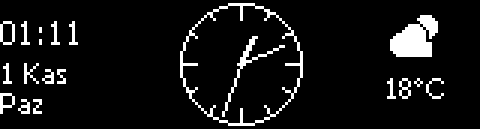
</p>

> The images are upscaled from the LCD's real 160×43 pixel output. The data shown is sample data.
> The on-screen interface is in Turkish.

## Features

- **7 pages:** system, media, RGB, weather & markets, news, game, animations
- **Automatic switching:** game page when a game starts, media page when playback starts, animations when idle
- **Windows notifications** (WhatsApp, Discord, e-mail…) shown on the LCD; the keyboard flashes in the app's color
- **Volume** overlay and **microphone muted** indicator
- **17 RGB lighting modes:** rainbow, breathing, color by system load or GPU temperature, the color of the platform you're watching…
- **Game mode:** the game's logo, a big FPS counter, GPU/CPU load and temperatures (via MSI Afterburner)
- **Tray icon** menu and **automatic updates**
- No administrator rights needed

## Pages

### System
CPU load, live clock speed and temperature, per-core bars; NVIDIA GPU temperature/load/VRAM; clock, RAM and disk.
Key 4 shows the top CPU processes, key 3 opens Task Manager.

<p>
  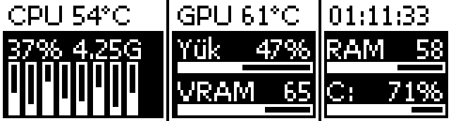
  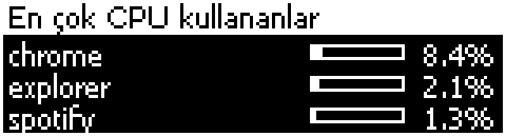
</p>

### Media
Title, artist and progress from the Windows media session. The source icon is picked automatically: Spotify,
YouTube, Netflix, Twitch, Kick, X, Instagram, TikTok, Prime Video, Disney+, SoundCloud…
Key 3 play/pause, key 4 next track.

<p>
  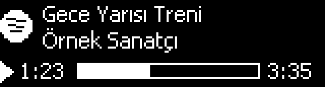
  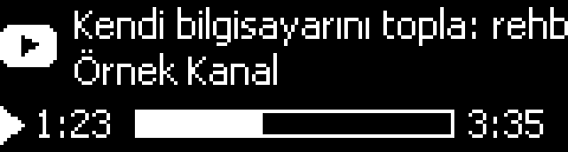
</p>

### Weather & Markets
Location is detected from Windows. Current weather, high/low, wind; USD, EUR and gram gold prices in TRY.
Key 4 opens the 3-day forecast.

<p>
  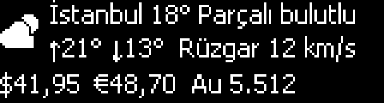
  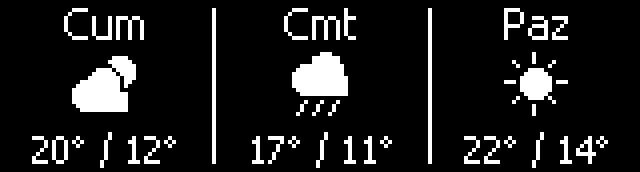
</p>

### News and RGB
Headlines from Turkish and tech RSS feeds scroll in turn; key 4 opens the story in the browser.
On the RGB page the lighting mode is picked with the LCD keys; live R/G/B levels are shown on the right.

<p>
  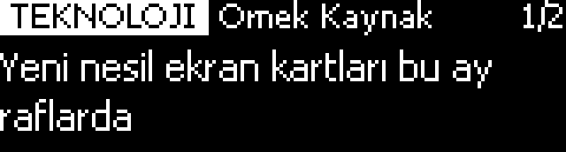
  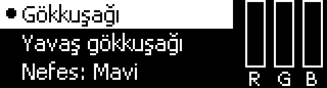
</p>

### Game
Opens when a full-screen game is in the foreground. Known games (PUBG, CS2, Dota 2, LoL, Valorant, Onimusha…) and
publishers (Steam, Epic, Rockstar, EA, Ubisoft, Battle.net, Xbox…) get crisp logos drawn for the LCD;
for other games the exe icon is downscaled and dithered.

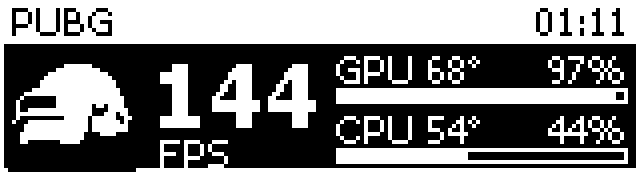

### Overlays
Notifications stay on screen for 12 seconds; a volume bar appears when the volume changes. When you switch pages,
the page name and its key functions are shown briefly.

<p>
  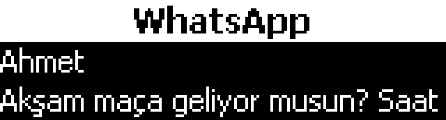
  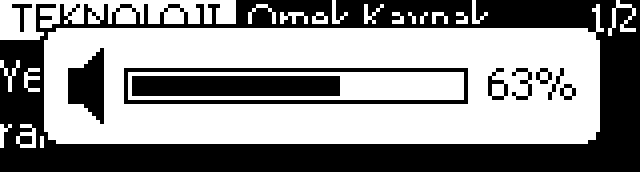
</p>
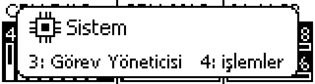

### Animations
When the keyboard and mouse are idle (3 minutes by default), animations start and change every minute:

| | | | |
|---|---|---|---|
| 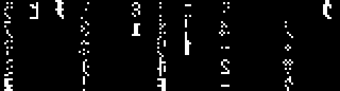 Matrix |  Analog clock | 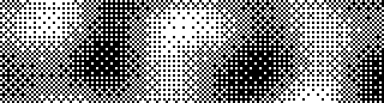 Plasma |  Fire |
|  3D cubes |  Robot |  Starfield | 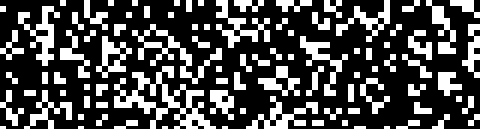 Game of Life |

## Keys

The 4 keys below the screen: **1** previous page, **2** next page, **3 / 4** depend on the page:

| Page | Key 3 | Key 4 |
|---|---|---|
| System | Open Task Manager | Top CPU processes |
| Media | Play / pause | Next track |
| RGB | Move cursor down | Apply selected mode |
| Weather & Markets | Refresh now | 3-day forecast |
| News | Next headline | Open in browser |
| Game | Toggle game mode | — |
| Animations | Restart | Next animation |

While a notification is shown, any key dismisses it first.

## Automatic switching

- With a full-screen game in the foreground the **Game** page opens (full-screen video in a browser doesn't count).
- When media starts playing the **Media** page opens.
- With no media the home page is **News**; in the last 20 seconds of every minute **Weather** and **System** are shown for 10 s each.
- After you press an LCD key, automatic switching pauses for 60 seconds (except when media starts).

Timings can be changed with the `ARA_SN`, `HABER_SN`, `MANUEL_SN` and `MEDYA_BEKLE_SN` constants at the top of `g510_panel.py`.

## Installation

1. [Logitech Gaming Software 9.x](https://support.logi.com/) must be installed and running (LGS, not G HUB).
2. Download `G510-Panel.exe` from [Releases](../../releases), put it in a folder and run it.
3. To start it with Windows, put a shortcut to the exe in the `shell:startup` folder.

Settings (`ayarlar.json`) and the log (`g510_panel.log`) are kept next to the exe.

**Tray icon:** toggle automatic page switching, game mode and notifications, idle animation delay
(off / 1 / 3 / 5 / 10 min), RGB mode, update, open log, restart, exit.

**Updates:** the app checks this repository's latest release at startup and every 6 hours; when a new one is out it
shows a notice, and **Güncelle** (Update) in the tray menu downloads it and replaces itself.

### Optional
- **[MSI Afterburner](https://www.msi.com/Landing/afterburner/graphics-cards) + RTSS** running: CPU temperature and
  in-game FPS (read from shared memory, no admin rights).
- **NVIDIA driver** (`nvidia-smi`) for the GPU panel.
- **Windows location permission** for the automatic city; otherwise set a city name in the `SEHIR` constant.
- **Notification access** to show Windows notifications (Windows asks on first run).

## Development

Requires Python 3.11+.

```bash
pip install -r requirements.txt
python g510_panel.py              # run on the LCD
python g510_panel.py --onizleme   # no LCD: runs the self-tests and saves pages as onizleme_*.png
```

Build a single exe:

```bash
pip install pyinstaller
pyinstaller --onefile --noconsole --name "G510 Panel" --collect-submodules winrt g510_panel.py
```

### How it works
- The screen and keys are driven by the **Logitech LCD SDK** (`LogitechLcd.dll`), the lighting by the **LED SDK**
  (`LogitechLed.dll`); both ship with LGS.
- Every frame is drawn with Pillow as a 160×43 monochrome image; text is rendered in bitmap mode and icons are
  hand-drawn pixel by pixel.
- Measurements, media (Windows GlobalSystemMediaTransportControls), notifications (UserNotificationListener),
  volume (pycaw), weather, news and RGB each run in their own thread.

### Extra tools
- `oyun_ikonlari_uret.py`: renders [Simple Icons](https://simpleicons.org) (CC0) logos in Chrome, converts them to
  32×32 monochrome icons and embeds them in `oyun_ikonlari.py`.
- `gtus_kartlari.py`: reads the G1–G18 × M1–M3 assignments of an LGS profile and generates a printable reference
  card and key labels (`G-tuslari.html`); also outputs PNGs for 57 mm thermal printers.

## Data sources

Weather: [Open-Meteo](https://open-meteo.com) · Place name: [OpenStreetMap Nominatim](https://nominatim.org) ·
Exchange rates: [Truncgil Finans](https://finans.truncgil.com) · News: BBC Türkçe, Techolay, Webtekno RSS ·
Game logos: [Simple Icons](https://simpleicons.org) (CC0)

## License

[MIT](LICENSE). Logitech, G510 and other trademarks belong to their owners; this project is not affiliated with Logitech.
