# G510 LCD Panel

**Türkçe** | [English](README.en.md)

**Logitech G510 / G510s** klavyenin 160×43 tek renkli LCD ekranını ve RGB arka ışığını canlandıran Windows
uygulaması. Sistem durumu, çalan medya, hava ve piyasa, haberler, oyun FPS'i, Windows bildirimleri ve boştayken
ekran koruyucu animasyonlar: hepsi tek bir `.exe` içinde.

<p align="center">
  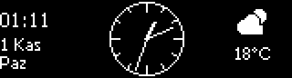
</p>

> Görseller LCD'nin gerçek 160×43 piksel çıktısının büyütülmüş hâlidir. Ekrandaki veriler örnektir.

## Özellikler

- **7 sayfa:** sistem, medya, RGB, hava & piyasa, haberler, oyun, animasyon
- **Otomatik geçişler:** oyun açılınca oyun sayfası, medya başlayınca medya sayfası, boştayken animasyonlar
- **Windows bildirimleri** (WhatsApp, Discord, e-posta…) ekranda gösterilir; klavye uygulamanın renginde yanıp söner
- **Ses seviyesi** göstergesi ve **mikrofon sessiz** uyarısı
- **17 RGB ışık modu:** gökkuşağı, nefes, sistem yüküne ya da GPU sıcaklığına göre renk, izlenen platformun rengi…
- **Oyun modu:** oyunun logosu, büyük FPS sayacı, GPU/CPU yük ve sıcaklıkları (MSI Afterburner ile)
- **Tepsi simgesi** menüsü ve **otomatik güncelleme**
- Türkçe arayüz; yönetici izni istemez

## Sayfalar

### Sistem
CPU yükü, anlık frekans ve sıcaklık, çekirdek başına çubuklar; NVIDIA GPU sıcaklık/yük/VRAM; saat, RAM ve disk.
4. tuş en çok CPU kullanan işlemleri gösterir, 3. tuş Görev Yöneticisi'ni açar.

<p>
  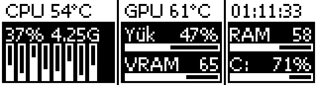
  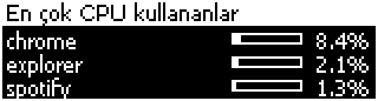
</p>

### Medya
Windows'un medya oturumundan çalan parça, sanatçı ve ilerleme. Kaynak simgesi otomatik seçilir: Spotify,
YouTube, Netflix, Twitch, Kick, X, Instagram, TikTok, Prime Video, Disney+, SoundCloud…
3. tuş oynat/duraklat, 4. tuş sonraki parça.

<p>
  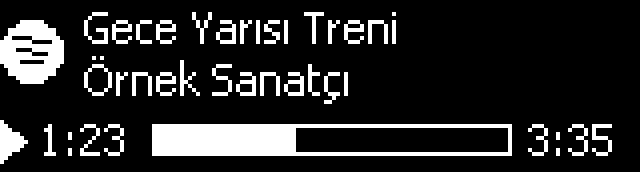
  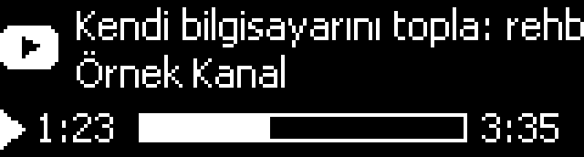
</p>

### Hava & Piyasa
Konum Windows'tan otomatik bulunur. Anlık hava, en yüksek/en düşük sıcaklık, rüzgâr; dolar, euro ve gram altın.
4. tuş 3 günlük tahmini açar.

<p>
  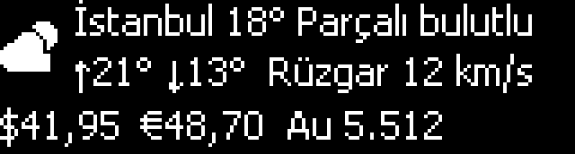
  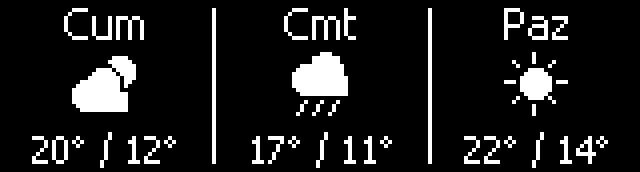
</p>

### Haberler ve RGB
Türkiye ve teknoloji RSS başlıkları sırayla kayar; 4. tuş haberi tarayıcıda açar.
RGB sayfasında ışık modu LCD tuşlarıyla seçilir; anlık R/G/B değerleri sağda görünür.

<p>
  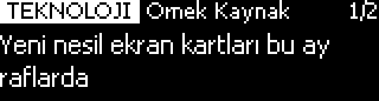
  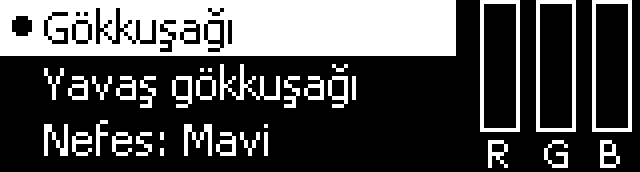
</p>

### Oyun
Tam ekran bir oyun öndeyken açılır. Bilinen oyunlar (PUBG, CS2, Dota 2, LoL, Valorant, Onimusha…) ve
yayıncılar (Steam, Epic, Rockstar, EA, Ubisoft, Battle.net, Xbox…) için LCD'ye özel çizilmiş net logolar;
diğer oyunlarda exe simgesi küçültülüp titreştirilir.

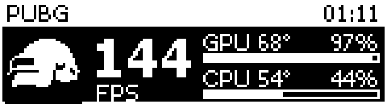

### Ekran üstü katmanlar
Bildirimler 12 saniye ekranda kalır; ses değişince ortada ses çubuğu belirir. Sayfa değiştirince sayfanın adı ve
tuş görevleri kısa süre görünür.

<p>
  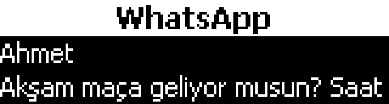
  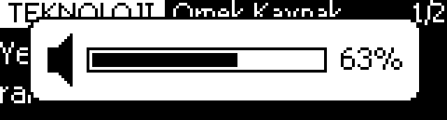
</p>
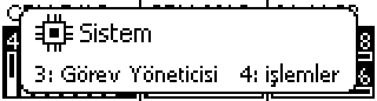

### Animasyonlar
Klavye ve fareye bir süre dokunulmazsa (varsayılan 3 dk) dakikada bir değişen animasyonlar başlar:

| | | | |
|---|---|---|---|
| 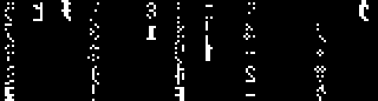 Matrix |  Analog saat |  Plazma |  Ateş |
|  3D küpler |  Robot |  Yıldızlar | 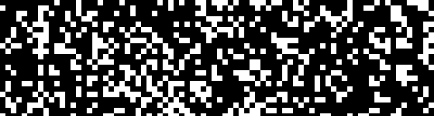 Hayat Oyunu |

## Tuşlar

Ekranın altındaki 4 tuş: **1** önceki sayfa, **2** sonraki sayfa, **3 / 4** sayfaya göre:

| Sayfa | 3. tuş | 4. tuş |
|---|---|---|
| Sistem | Görev Yöneticisi'ni aç | En çok CPU kullanan işlemler |
| Medya | Oynat / duraklat | Sonraki parça |
| RGB | İmleç aşağı | Seçili modu uygula |
| Hava & Piyasa | Hemen yenile | 3 günlük tahmin |
| Haberler | Sonraki haber | Haberi tarayıcıda aç |
| Oyun | Oyun modunu aç/kapat | — |
| Animasyon | Baştan başlat | Sonraki animasyon |

Bildirim ekrandayken herhangi bir tuş önce bildirimi kapatır.

## Otomatik geçişler

- Tam ekran oyun öndeyken **Oyun** sayfası açılır (tarayıcıda tam ekran video oyun sayılmaz).
- Medya çalmaya başlayınca **Medya** sayfası açılır.
- Medya yokken ana sayfa **Haberler**'dir; her dakikanın son 20 saniyesinde 10 sn **Hava**, 10 sn **Sistem** gösterilir.
- LCD tuşuna basınca otomatik geçişler 60 saniye bekler (medya başlaması hariç).

Süreler `g510_panel.py` başındaki `ARA_SN`, `HABER_SN`, `MANUEL_SN`, `MEDYA_BEKLE_SN` sabitleriyle değiştirilebilir.

## Kurulum

1. [Logitech Gaming Software 9.x](https://support.logi.com/) kurulu ve açık olmalı (G HUB değil, LGS).
2. [Releases](../../releases) sayfasından `G510-Panel.exe` dosyasını indirip bir klasöre koy ve çalıştır.
3. Windows açılışında başlaması için exe'nin kısayolunu `shell:startup` klasörüne ekle.

Ayarlar (`ayarlar.json`) ve hata kaydı (`g510_panel.log`) exe'nin yanında tutulur.

**Tepsi simgesi:** otomatik sayfa geçişi, oyun modu ve bildirimleri aç/kapat, animasyon bekleme süresi
(kapalı / 1 / 3 / 5 / 10 dk), RGB modu, güncelleme, kayıt dosyası, yeniden başlat, çıkış.

**Güncelleme:** uygulama açılışta ve 6 saatte bir bu deponun son sürümünü denetler; yenisi varsa ekranda bildirir,
tepsi menüsündeki **Güncelle** ile indirip kendini değiştirir.

### İsteğe bağlı
- **[MSI Afterburner](https://www.msi.com/Landing/afterburner/graphics-cards) + RTSS** açıksa CPU sıcaklığı ve oyunda
  FPS gösterilir (paylaşılan bellekten, yönetici izni olmadan okunur).
- **NVIDIA sürücüsü** (`nvidia-smi`) GPU paneli için.
- **Windows konum izni** otomatik şehir için; kapalıysa `SEHIR` sabitine şehir adı yazılabilir.
- **Bildirim erişimi** Windows bildirimlerini göstermek için (ilk açılışta Windows sorar).

## Geliştirme

Python 3.11+ gerekir.

```bash
pip install -r requirements.txt
python g510_panel.py              # LCD'de çalıştır
python g510_panel.py --onizleme   # LCD'siz: testleri çalıştırır, sayfaları onizleme_*.png olarak kaydeder
```

Tek exe olarak paketleme:

```bash
pip install pyinstaller
pyinstaller --onefile --noconsole --name "G510 Panel" --collect-submodules winrt g510_panel.py
```

### Nasıl çalışır?
- Ekran ve tuşlar **Logitech LCD SDK** (`LogitechLcd.dll`), ışık **LED SDK** (`LogitechLed.dll`) ile sürülür;
  ikisi de LGS ile birlikte gelir.
- Her kare Pillow ile 160×43 tek renkli görüntü olarak çizilir; yazılar bitmap modunda, simgeler piksel piksel elle
  çizilmiştir.
- Ölçüm, medya (Windows GlobalSystemMediaTransportControls), bildirim (UserNotificationListener), ses (pycaw),
  hava, haber ve RGB ayrı iş parçacıklarında çalışır.

### Ek araçlar
- `oyun_ikonlari_uret.py`: [Simple Icons](https://simpleicons.org) (CC0) logolarını Chrome'da çizip 32×32 tek
  renkli ikonlara çevirir ve `oyun_ikonlari.py`'ye gömer.
- `gtus_kartlari.py`: LGS profilindeki G1–G18 × M1–M3 atamalarını okuyup yazdırılabilir başvuru kartı ve
  tuşlara yapıştırılacak etiketler (`G-tuslari.html`) üretir; 57 mm termal yazıcılar için PNG çıktısı da verir.

## Veri kaynakları

Hava: [Open-Meteo](https://open-meteo.com) · Konum adı: [OpenStreetMap Nominatim](https://nominatim.org) ·
Kur: [Truncgil Finans](https://finans.truncgil.com) · Haberler: BBC Türkçe, Techolay, Webtekno RSS ·
Oyun logoları: [Simple Icons](https://simpleicons.org) (CC0)

## Lisans

[MIT](LICENSE). Logitech, G510 ve diğer marka adları sahiplerine aittir; bu proje Logitech ile bağlantılı değildir.
